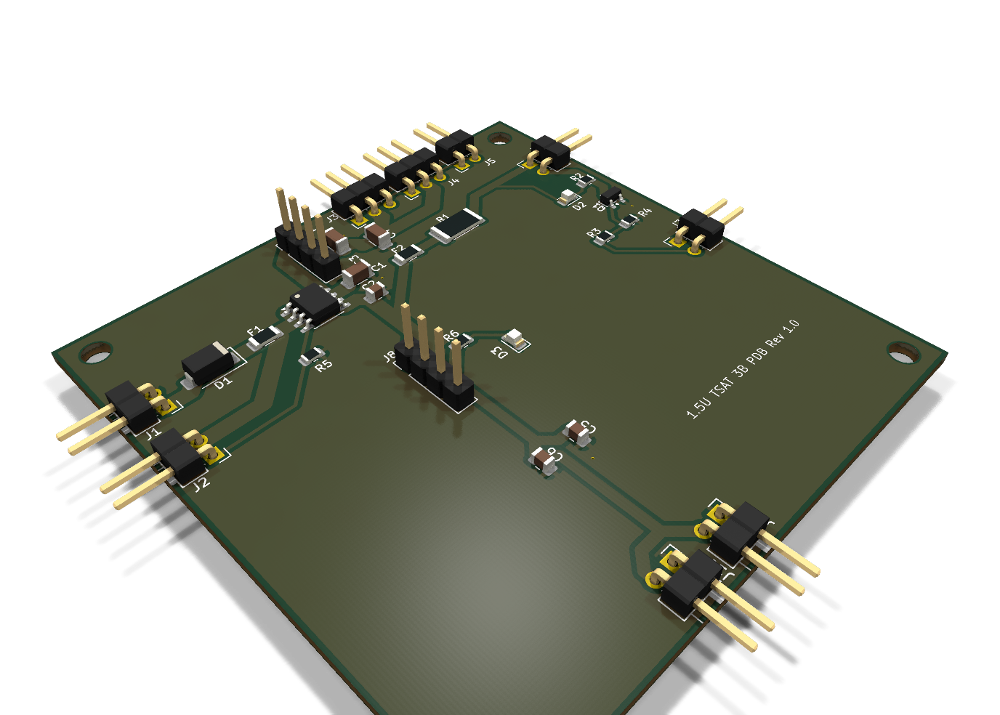
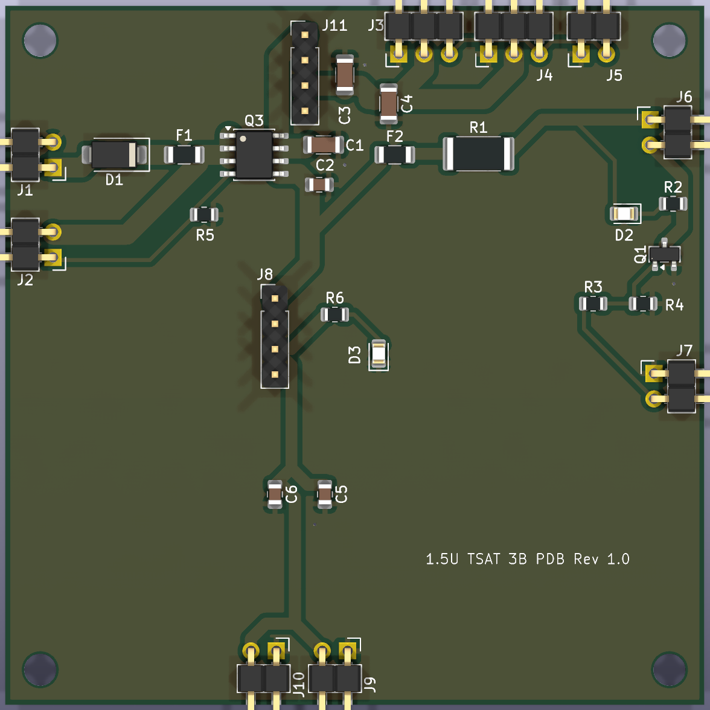
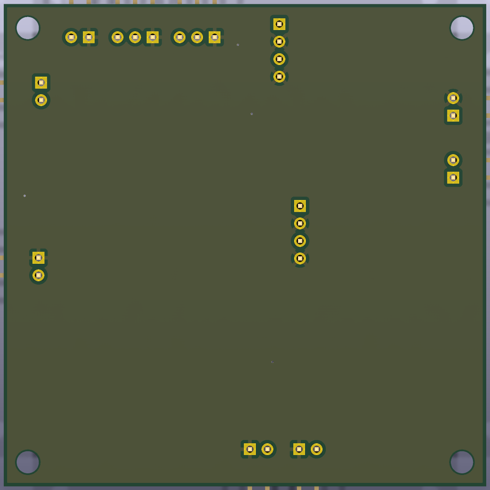

# 1.5U TSat-3B power distribution board, Rev 1.0

<p align="center">
  
</p>

<p align="center">
  <b>Current design</b> &nbsp;·&nbsp; 70 × 70 mm &nbsp;·&nbsp; 2-layer, 1.6 mm &nbsp;·&nbsp; KiCad 10
</p>

| Top | Bottom |
|:---:|:---:|
|  |  |

📄 **Schematic:** [PDF](docs/schematic.pdf) &nbsp;·&nbsp; 🧾 **BOM:** [CSV](bom/BOM.csv) &nbsp;·&nbsp; 🏭 **Fabrication:** [Gerbers + drill](fabrication/)

This board doesn't regulate anything itself. It switches, fuses and distributes battery power, and two off-the-shelf buck modules
plug into it to make the 5 V and 7.4 V rails.

## Power tree

```
3S LiPo (J1)
  └─ D1 SS54 reverse-polarity diode
       └─ F1 7 A fuse
            └─ Q3 AO4407A P-MOSFET switch ◄── J2 remove-before-flight jumper (fitted = OFF)
                 └─ VBAT_MAIN
                      ├─ J11 → XL4015 buck module → +7V4_SERVO → J3, J4 servo headers (GND, 7.4 V, data)
                      ├─ J8  → MP1584 buck module → +5V_LOGIC  → J9 main board, J10 ESP32 camera, D3 power LED
                      └─ F2 5 A fuse → R1 (0 Ω) → J6 nichrome cutter, low side switched by Q1 AO3400A
                                                   (gate from J7; D2 lights while the cutter fires)
```

J5 carries the servo data line in from the servo adapter to both servo headers.

## Connectors

| Ref | Function | Pins |
|---|---|---|
| J1 | 3S LiPo in | 2 |
| J2 | Arm jumper. Fitted = board off; remove to power on | 2 |
| J3, J4 | Servo 1 and 2 | GND, +7.4 V, data |
| J5 | Servo data in | 2 |
| J6 | Nichrome cutter out | 2 |
| J7 | Cutter trigger in (from main board) | 2 |
| J8 | MP1584 module | VBAT, GND, +5 V, GND |
| J9 | 5 V to main board | 2 |
| J10 | 5 V to ESP32 camera | 2 |
| J11 | XL4015 module | VBAT, GND, +7.4 V, GND |

## Checks

KiCad 10 on 2026-11-17: ERC 0 errors, DRC 0 violations, 0 unconnected items, schematic and PCB match. The Gerbers in
`fabrication/` are the ones exported from this exact PCB file.

## Files

- `Power Distrubution board.kicad_pro` / `.kicad_sch` / `.kicad_pcb`: the KiCad project. The file names keep the original spelling,
  because KiCad stores the project name inside the schematic and renaming the files would break the reference designators.
- `TSAT3B.kicad_sym`: the club symbol library (AO4407A).
- `docs/`: schematic PDF and board renders, exported from the KiCad files with `kicad-cli`.
- `bom/BOM.csv`: grouped bill of materials, exported from the schematic.
- `fabrication/`: Gerbers and drill files to send to the board house.
