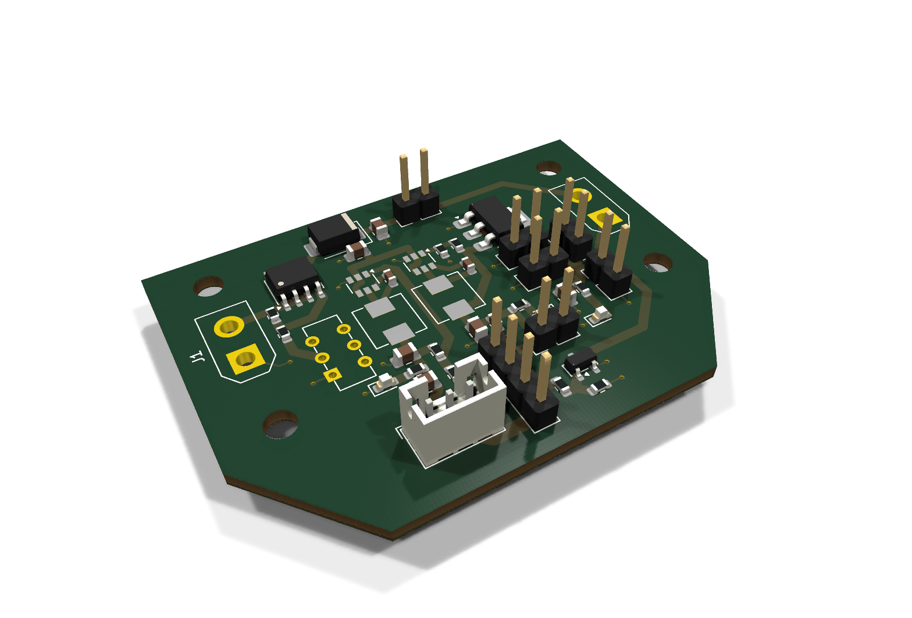
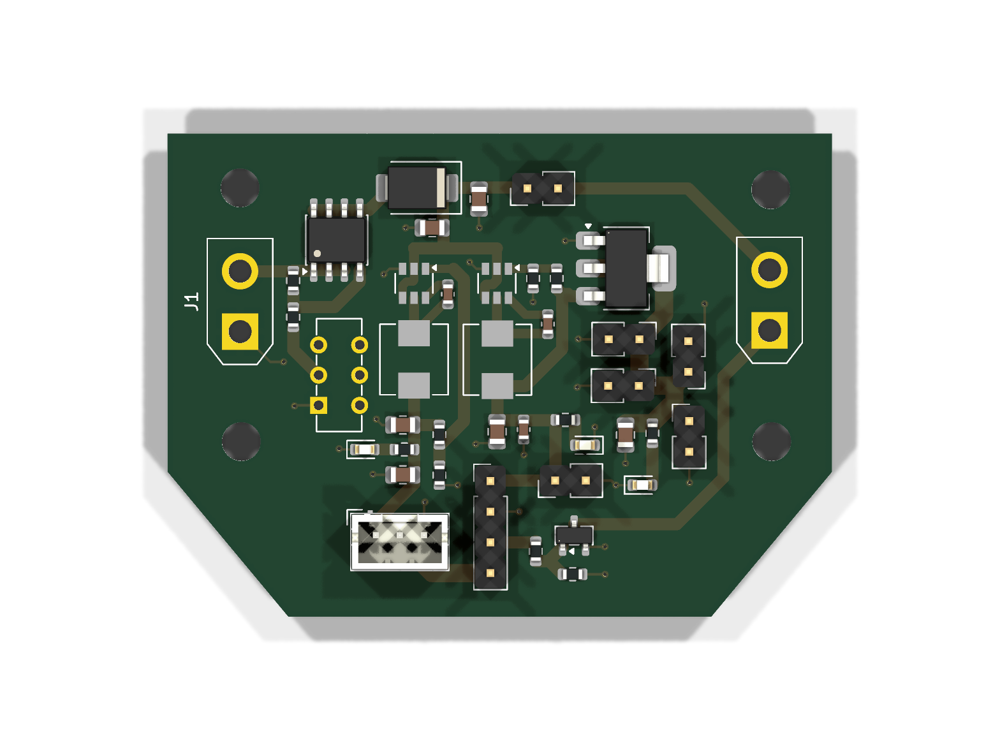
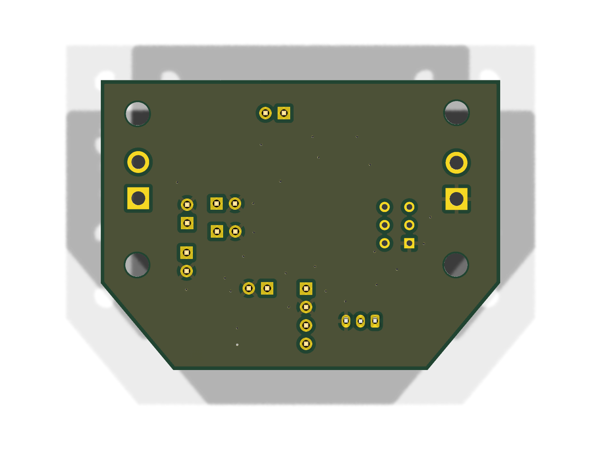

# TSat-3B Power Distribution Board

<p align="center">
  
</p>

<p align="center">
  <b>Rev B: review draft</b> &nbsp;·&nbsp; 55 × 40 mm &nbsp;·&nbsp; 2-layer, 1.6 mm &nbsp;·&nbsp; KiCad 10
</p>

This board takes the battery and makes every rail TSat-3B needs. It powers the flight computer, the radio, the GPS, the IMU,
the SD card and the parafoil servo, and it switches the cutter channel.

| Top | Bottom |
|:---:|:---:|
|  |  |

📄 **Schematic:** [PDF](docs/TSAT3B_PDB_schematic.pdf) · [SVG](docs/TSAT3B_PDB_schematic.svg)
&nbsp;&nbsp;🧾 **BOM:** [CSV](bom/TSAT3B_PDB_BOM.csv)
&nbsp;&nbsp;🏭 **Fabrication:** [Gerbers + drill (zip)](fabrication/TSAT3B_PDB_gerbers.zip)

## Power tree

```
 Battery (J1, XT30)
   │
   ├─ Q3 AO4407A P-MOSFET load switch ◄── SW1 slide switch (gate control only, R12/R13)
   │
   └─ D1 SS54 reverse-polarity diode ──► VBUS
        │
        ├─ U1 SY8105 buck ───────► +5V   (73.2k / 10k  → 4.99 V)
        │     └─ U3 TLV1117LV33 ─► +3V3
        │
        ├─ U2 SY8105 buck ───────► VSERVO (73.2k / 8.2k → 5.96 V)
        │
        └─ J2 ARM LINK jumper ───► CUT_PWR ──► J11 cutter (Q1 AO3400A low-side switch)
```

Each rail (+5V, +3V3, VSERVO) has a green indicator LED.

## Connectors

| Ref | Name | Pins | Notes |
|---|---|---|---|
| J1 | BATTERY | XT30 | Battery input |
| J2 | ARM LINK | 2 × 2.54 mm | Jumper links VBUS → CUT_PWR to arm the cutter |
| J3 | PICO | +5V, GND | |
| J4 | LoRa | +3V3, GND | |
| J5 | GPS | +3V3, GND | |
| J6 | IMU | +3V3, GND | |
| J7 | SD CARD | +3V3, GND | |
| J8 | SERVO 1 | VSERVO, PWM, GND | JST PH 3-pin |
| J9 | ESP32 interface | +5V, GND, CUT1_CMD, SERVO1_PWM | 4 × 2.54 mm |
| J11 | CUTTER 1 | CUT_PWR, switched drain | XT30 |

## Bill of materials

42 parts, 25 line items. MPNs are in the [BOM CSV](bom/TSAT3B_PDB_BOM.csv).

| Qty | Refs | Part | Value / MPN |
|---:|---|---|---|
| 2 | U1, U2 | Buck regulator, Silergy | SY8105IADC |
| 1 | U3 | 3.3 V LDO, TI | TLV1117LV33DCYR |
| 1 | Q3 | P-MOSFET load switch, AOS | AO4407A |
| 1 | Q1 | N-MOSFET cutter switch, AOS | AO3400A |
| 1 | D1 | Schottky diode | SS54SMB |
| 2 | L1, L2 | Inductor, TDK | 2.2 µH SPM5030VT-2R2M-D |
| 6 | C1, C2, C4, C6–C8 | Capacitor 0805 | 22 µF 25 V |
| 3 | C3, C5, C9 | Capacitor 0603 | 100 nF 50 V |
| 11 | R1–R9, R12, R13 | Resistors 0603 | 73.2k, 10k, 8.2k, 1k, 100R |
| 3 | D2–D4 | LED 0603 | Green |
| 1 | SW1 | Slide switch | MSS22D18G2 |
| 2 | J1, J11 | Connector | XT30UPB-M |
| 8 | J2–J9 | Headers | 2.54 mm / JST PH |

## Repository layout

```
PowerDistributionBoard/
├── TSAT3B_PDB.kicad_pro / .kicad_sch / .kicad_pcb   KiCad 10 project
├── TSAT3B.kicad_sym, TSAT3B.pretty/                 project symbol + footprint library
├── fp-lib-table, sym-lib-table                      point at the local library (${KIPRJMOD})
├── fabrication/                                     Gerbers, drill files, job file, zip
├── bom/                                             BOM (CSV)
└── docs/                                            schematic PDF/SVG and 3D renders
```

Open `TSAT3B_PDB.kicad_pro` in **KiCad 10 or newer**; KiCad 9 can't read these files. The custom parts in
`TSAT3B.pretty` (XT30, slide switch, inductors, SY8105) have no 3D models yet, so they show as bare pads in the renders.

## Status: open items before fabrication

Rev B is still a **review draft**. These come from the review notes in the schematic:

- [ ] Battery voltage/specification. The design assumes a supply that suits the 6 V buck and the switch's ≤12 V rating.
- [ ] Cutter: resistance/current, pulse duration and Q1 thermal/SOA check.
- [ ] Q3 and D1 current, inrush and dissipation, once battery and load data are known.
- [ ] VSERVO at 5.96 V: confirm it suits the servos.
- [ ] Verify land patterns: SY8105 (TSOT23-6), TDK inductor, XT30 (also polarity), and the slide switch contacts.
- [ ] Confirm harness polarity on all 2-pin headers, and the servo pin order (1 VSERVO, 2 PWM, 3 GND).
- [ ] Arming-link topology (VBUS → CUT_PWR): verify against the source design.
- [ ] Cross-check with the flight code: the parafoil controller in [`../FlightController`](../FlightController) drives
      **two** winch servos (left and right lines). This board has one servo header (J8) and one PWM line on J9.

Check results (KiCad 10.0.7):
- **DRC:** 0 unconnected pads and no clearance errors.
- **Parity:** the 4 mounting holes exist only on the PCB.
- **ERC:** 3 "power pin not driven" errors, which usually just need `PWR_FLAG` symbols on GND / VBAT_RAW / VBUS.
