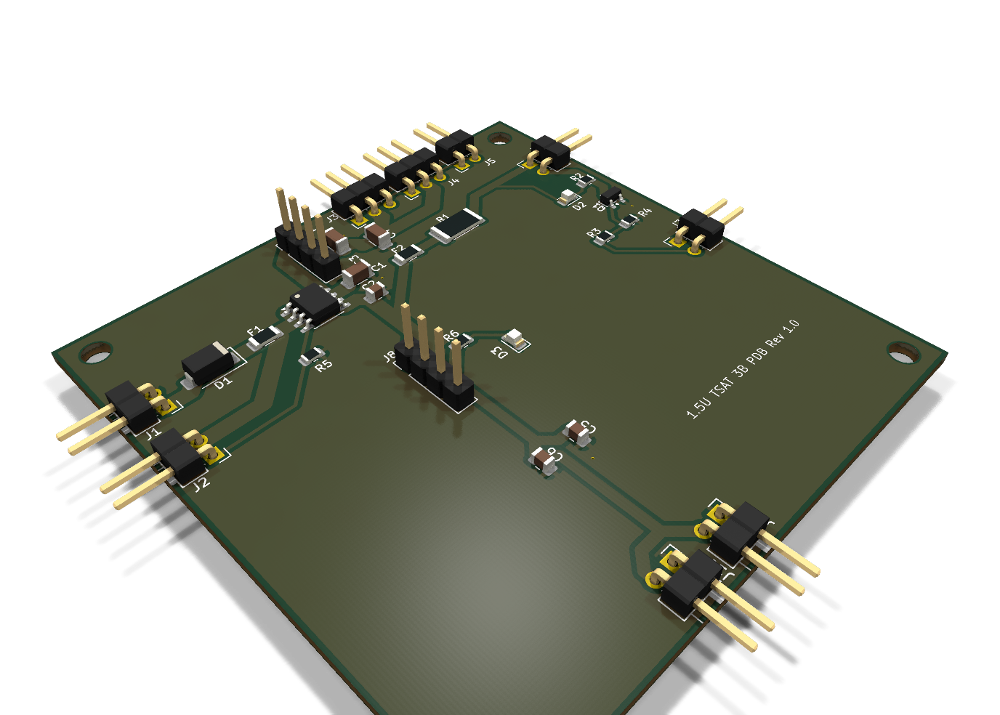
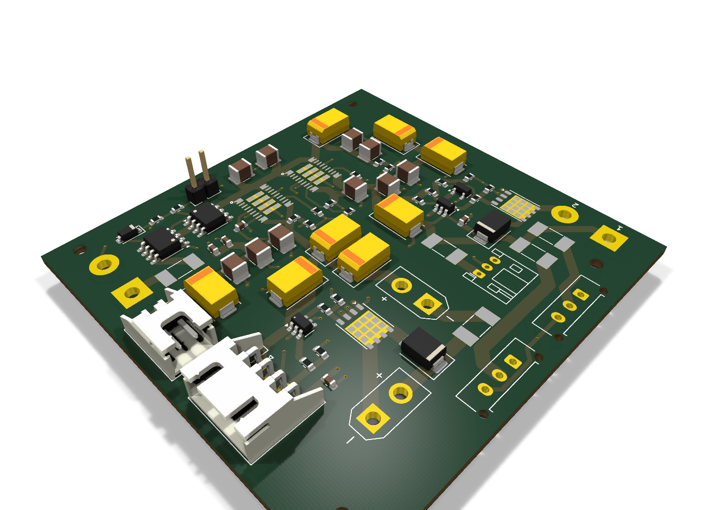

# Power distribution board

The power board takes the 3S LiPo and supplies every other part of TSat-3B: the flight computer, the camera, both steering servos
and the nichrome cutter.

**Two candidate designs are being reviewed** to choose the one going forward. Rev B came before both and is kept for reference.

| Design | Designer | Size | Regulators | Status |
|---|---|---|---|---|
| [`1.5U-Rev1/`](1.5U-Rev1/) | Eric P. | 70 × 70 mm, 2-layer | Off-board modules: XL4015 (7.4 V servos), MP1584 (5 V logic) | **Candidate**, under review |
| [`TPSM63610/`](TPSM63610/) | Lawson H. | 70 × 67 mm, 2-layer | On-board TI TPSM63610 × 2 (5.0 V logic, 7.2 V servos) | **Candidate**, under review |
| [`RevB-SY8105/`](RevB-SY8105/) | | 55 × 40 mm, 2-layer | On-board Silergy SY8105 × 2 (5 V logic, ~6 V servo) | Superseded |

| 1.5U-Rev1 | TPSM63610 |
|:---:|:---:|
|  |  |

All three are KiCad 10 projects. Open the `.kicad_pro` file in each folder. Review feedback is tracked in issues: [#7 1.5U-Rev1](https://github.com/UCF-Knights-Satellite-Club/tsat-3b/issues/7), [#8 TPSM63610](https://github.com/UCF-Knights-Satellite-Club/tsat-3b/issues/8).

Once a design is chosen, mark the other one superseded in this table and in its README. Don't delete it.
