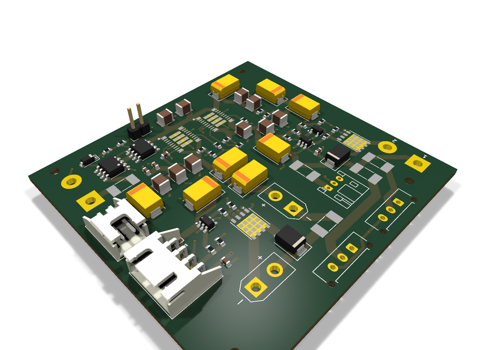
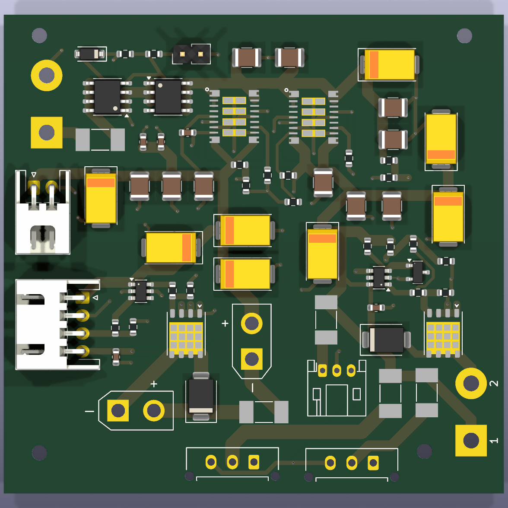
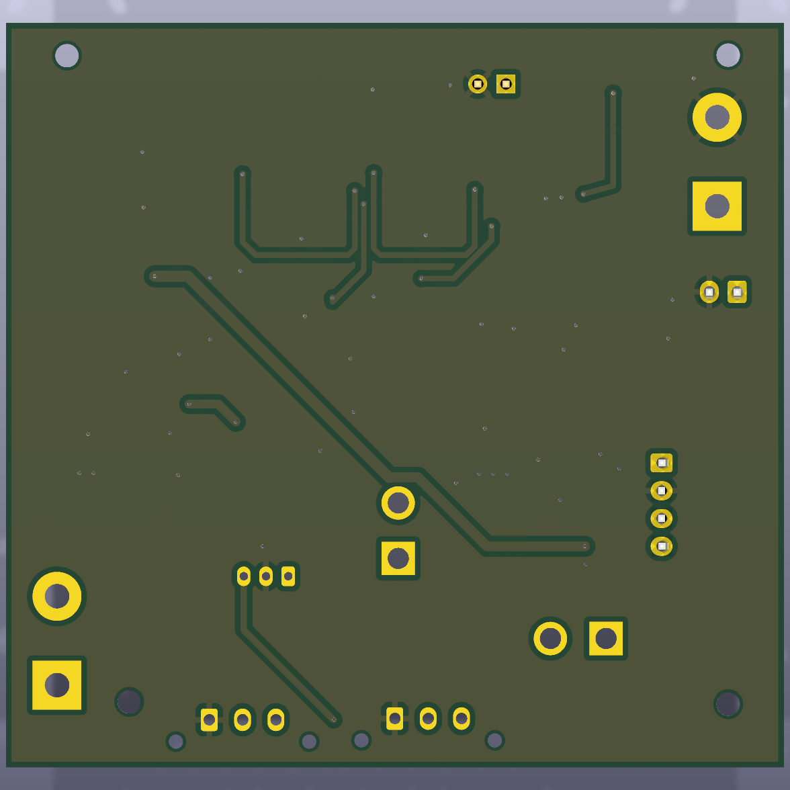

# TSAT-3B-PDB (on-board TPSM63610 regulators)

  

  <b>Candidate, under review</b> &nbsp;·&nbsp; Designer: Lawson H. &nbsp;·&nbsp; 70 × 67 mm &nbsp;·&nbsp; 2-layer &nbsp;·&nbsp; KiCad 10

| Top | Bottom |
|:---:|:---:|
|  |  |

📄 **Schematic:** [PDF](docs/schematic.pdf) &nbsp;·&nbsp; 🧾 **BOM:** [CSV with suppliers](bom/TSAT-3B-PDB_BOM.csv)
&nbsp;·&nbsp; 🔌 **Wiring:** [notes](docs/wiring.md) &nbsp;·&nbsp; 📝 [Review log](docs/review-notes.md)

70 parts. Two TI TPSM63610 buck modules on the board make 5.0 V logic and 7.2 V servo power from a 3S battery. It also has a main
input switch, fused outputs for two servos, a nichrome cutter channel, external brake resistors, battery voltage sensing and a 5 V
output for a camera board. Some 3D models are missing, so the renders show bare pads for the TPSM63610s and a few connectors.

- Open `TSAT-3B-PDB.kicad_pro` in KiCad 10. The symbol and footprint libraries it needs are in `Libraries/`.
- No Gerbers yet. Export them once this design is chosen.

Unpacked from `TSAT-3B-PDB.zip` (uploaded in PR #2). The lock files, KiCad local settings, the `.history/` folder and the review
tool output (`Review/`, `.patch`) from that zip were left out.

## Review

Design review feedback is tracked in [issue #8](https://github.com/UCF-Knights-Satellite-Club/tsat-3b/issues/8).
