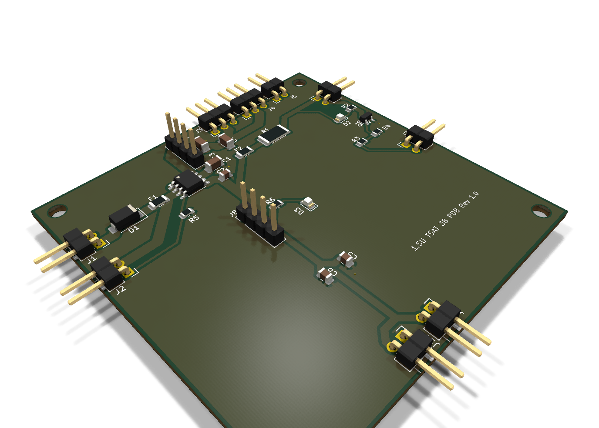

# tsat-3b

TSat-3B: a 1.5U CubeSat that is dropped from a tethered balloon and flies itself back to the launch site under a guided parafoil.
This repo holds the flight software and every circuit board.

## What's here

| Folder | What it is | Status |
|---|---|---|
| [`FlightController/`](FlightController/) | ESP32 guided-parafoil flight software (Arduino sketch) plus a PC simulator | Guidance done and tested in simulation; sensor drivers still stubbed |
| [`PowerDistributionBoard/1.5U-Rev1/`](PowerDistributionBoard/1.5U-Rev1/) | **Current** power board: carrier for plug-in buck modules (KiCad 10) | Rev 1.0 design; not yet ordered |
| [`PowerDistributionBoard/TPSM63610-draft/`](PowerDistributionBoard/TPSM63610-draft/) | Earlier power board with on-board TPSM63610 regulators | Superseded |
| [`PowerDistributionBoard/RevB-SY8105/`](PowerDistributionBoard/RevB-SY8105/) | Earliest power board with on-board SY8105 regulators | Superseded |
| [`MainBoard/`](MainBoard/) | Flight computer board (ESP32, IMU, GPS, barometer, LoRa) | Not uploaded yet |

See [`PowerDistributionBoard/README.md`](PowerDistributionBoard/README.md) for how the three power board designs differ.

## Contributing

Read [`CONTRIBUTING.md`](CONTRIBUTING.md) before you upload anything. In short: upload the KiCad project together with its
Gerbers, put files in the right folder, don't upload zips of whole projects, and write one sentence in the PR description.

## License

- Software (`FlightController/`): [MIT](LICENSE)
- Hardware designs (`PowerDistributionBoard/`, `MainBoard/`): [CERN Open Hardware Licence v2, Permissive (CERN-OHL-P-2.0)](LICENSE-HARDWARE)

Copyright (c) 2026 Knights Satellite Club
