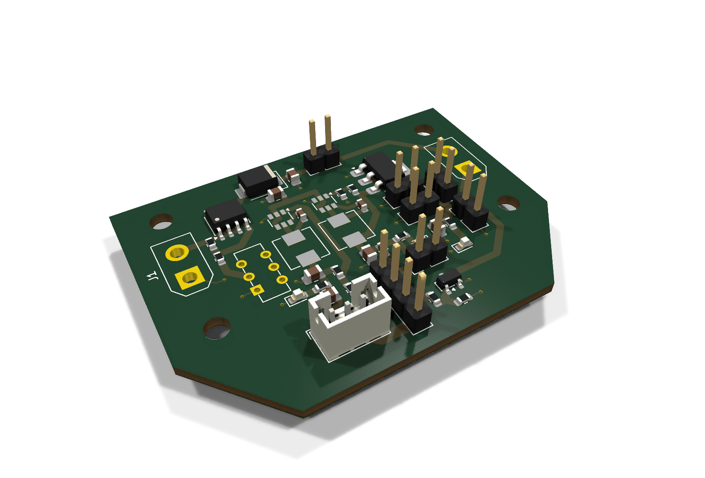

# tsat-3b
TSat-3B repository containing all kicads and guided parafoil descent code

- [`FlightController/`](FlightController/) - ESP32 guided parafoil flight controller (Arduino sketch). See its README.
- [`PowerDistributionBoard/`](PowerDistributionBoard/) - power distribution board (KiCad 10): schematic, PCB, Gerbers, BOM.

